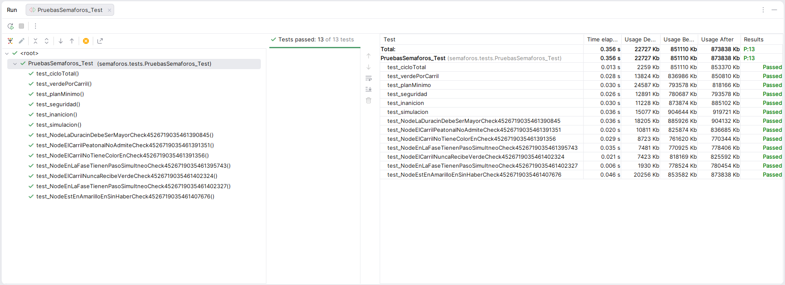

# DSL de Planes de Semáforos — JetBrains MPS

Lenguaje de Dominio Específico (DSL) para describir planes de semáforos de una intersección, con un razonador que verifica automáticamente que ningún plan otorgue paso simultáneo a carriles en conflicto y que todo carril reciba verde en cada ciclo.

Proyecto final — Compiladores, Universidad El Bosque.

## Requisitos

- **JetBrains MPS 2026.2** (otras versiones pueden no abrir el proyecto correctamente).
- No requiere plugins adicionales.

## Cómo abrir el proyecto

1. Clonar el repositorio.
2. En MPS: `File > Open` y seleccionar la carpeta raíz del repositorio.
3. Ejecutar `Build > Rebuild Project` (`Ctrl+F9`).
4. Abrir los modelos de ejemplo en `semaforos.sandbox > sandbox`.

## Estructura del repositorio

| Módulo / aspecto | Contenido |
|---|---|
| `semaforos` → `structure` | Metamodelo (AST): 14 conceptos |
| `semaforos` → `editor` | Proyección textual y proyección tabular (grid) de fases con color por estado |
| `semaforos` → `constraints` | Reglas de alcance (scoping) |
| `semaforos` → `typesystem` | Reglas de semántica estática |
| `semaforos.sandbox` | Modelos de prueba válidos e inválidos |
| `semaforos` → `behavior` | Razonador (R1–R7) |
| `semaforos` → `intentions` | Acción "Analizar intersección" |
| `semaforos` → `textGen` | Generación del reporte JSON |

## Ejemplo de modelo

```
interseccion Central {
  carriles: Norte, Sur, Este, Oeste
  conflictos: Norte - Este, Norte - Oeste, Sur - Este, Sur - Oeste
  F1  ( 30 s )  Norte = VERDE,    Sur = VERDE,    Este = ROJO,     Oeste = ROJO
  F2  ( 5 s )   Norte = AMARILLO, Sur = AMARILLO, Este = ROJO,     Oeste = ROJO
  F3  ( 30 s )  Norte = ROJO,     Sur = ROJO,     Este = VERDE,    Oeste = VERDE
  F4  ( 5 s )   Norte = ROJO,     Sur = ROJO,     Este = AMARILLO, Oeste = AMARILLO
}
```

## Reglas de semántica estática

| Regla | Descripción | Implementación |
|---|---|---|
| S1 | Las referencias a carriles solo apuntan a carriles de la misma intersección | Constraints (scope) |
| S2 | Nombres de carriles y fases únicos | Typesystem |
| S3 | Duración de fase mayor que 0 s | Typesystem |
| S4 | Cada carril tiene exactamente un color por fase | Typesystem |
| S5 | Un carril peatonal no admite AMARILLO | Typesystem |
| — | Conflictos irreflexivos y sin duplicados (C simétrica) | Typesystem |

## Modelos de prueba (`semaforos.sandbox`)

| Modelo | Tipo | Qué demuestra |
|---|---|---|
| `Central` | Válido | Caso base: 4 carriles, 4 fases |
| `ConPeatones` | Válido | Herencia: carril peatonal `Cebra` |
| `CruceT` | Válido | Topología en T: 3 carriles |
| `DuracionCero` | Inválido | S3: fase con duración 0 s |
| `PeatonAmarillo` | Inválido | S5: carril peatonal en AMARILLO |
| `AsignacionIncompleta` | Inválido | S4: carril sin color en una fase |
| `ConflictoReflexivo` | Inválido | Conflicto de un carril consigo mismo |
| `CarrilDuplicado` | Inválido | S2: nombre de carril repetido |

Los errores aparecen subrayados en el editor; al pasar el cursor se muestra el mensaje con la regla incumplida.

## Razonador

El razonador está implementado en el Behavior de `Interseccion` y analiza el plan como un sistema de transición cíclico, δ(fᵢ) = f₍ᵢ₊₁₎ mod n.

| Regla | Tipo | Descripción |
|---|---|---|
| R1 | Verificación | Ningún par de carriles en conflicto tiene paso (verde o amarillo) en la misma fase |
| R2 | Verificación | Todo carril recibe verde al menos una vez por ciclo (ausencia de inanición) |
| R3 | Inferencia | Ciclo total T y tiempo de verde G(l) por carril |
| R4 | Garantía | Toda fase termina (asegurado por S3: duración > 0) |
| R5 | Inferencia | Plan mínimo de fases mediante coloración voraz (Welsh-Powell) del grafo de conflictos |
| R6 | Simulación | Ejecución del plan k ciclos, mostrando fase activa, tiempo y color de cada carril |
| R7 | Verificación | Todo amarillo viene precedido de verde en la fase anterior |

**Cómo usarlo:**
- R1, R2 y R7 se marcan en vivo en el editor (errores y advertencias).
- `Alt+Enter` sobre una intersección → **Analizar intersección (R1–R7)** escribe el análisis completo en el bloque `resultado` del modelo.
- Para incluir la simulación, agregar `simular k ciclos` en la intersección antes de analizar.

**Modelos rechazados por el razonador** (cumplen S1–S5, pero violan propiedades del plan):

| Modelo | Regla violada |
|---|---|
| `ConflictoVerde` | R1: Norte y Este en verde a la vez |
| `CarrilOlvidado` | R2: Oeste nunca recibe verde |
| `AmarilloSinVerde` | R7 y R1: Este pasa de rojo a amarillo |

## Generación de reportes

El TextGen de `Interseccion` produce un archivo `<Nombre>_reporte.json` por cada intersección, con el resultado del razonador: ciclo total, verde por carril, verificación (R1, R2, R7), plan mínimo sugerido (R5) y simulación (R6).

**Para generarlos:** clic derecho sobre el modelo `sandbox` → **Rebuild Model**. Los archivos quedan en `semaforos.sandbox/source_gen/semaforos/sandbox/`.

**Ejemplos ya generados** en la carpeta [`ejemplos/`](ejemplos/):

| Archivo | Resultado |
|---|---|
| `Central_reporte.json` | Plan seguro, con simulación de 1 ciclo |
| `ConPeatones_reporte.json` | Plan seguro con carril peatonal |
| `ConflictoVerde_reporte.json` | Rechazado por R1 |
| `CarrilOlvidado_reporte.json` | Rechazado por R2 |

## Pruebas automatizadas

Clic derecho sobre `semaforos.tests` → **Run tests**.

**Resultado: 13 de 13 pruebas pasan.**



**Errores detectados (7):** anotaciones `has error` / `has warning` sobre el nodo exacto donde cada regla debe reportar. Los modelos válidos no llevan anotación, así que la prueba falla si aparece un error inesperado.

| Modelo | Nodo verificado | Regla |
|---|---|---|
| `DuracionCero` | Duración de F2 | S3 |
| `PeatonAmarillo` | Asignación `Cebra = AMARILLO` | S5 |
| `AsignacionIncompleta` | Fase F3 | S4 |
| `ConflictoVerde` | Fase F1 | R1 |
| `CarrilOlvidado` | Carril `Oeste` | R2 |
| `AmarilloSinVerde` | Fase F2 | R1 y R7 |

**Inferencias (6):** asserts sobre los resultados del razonador.

| Prueba | Verifica |
|---|---|
| `cicloTotal` | R3: T = 70 s (Central) y 68 s (CruceT) |
| `verdePorCarril` | R3: G(Norte) = 40 s y G(Este) = 20 s en CruceT |
| `planMinimo` | R5: plan mínimo de 2 fases verdes |
| `seguridad` | R1: Central sin conflictos y ConflictoVerde con conflictos |
| `inanicion` | R2: Central sin inanición y CarrilOlvidado con 1 carril sin verde |
| `simulacion` | R6: 4 pasos por ciclo (1 ciclo = 4, 2 ciclos = 8) |